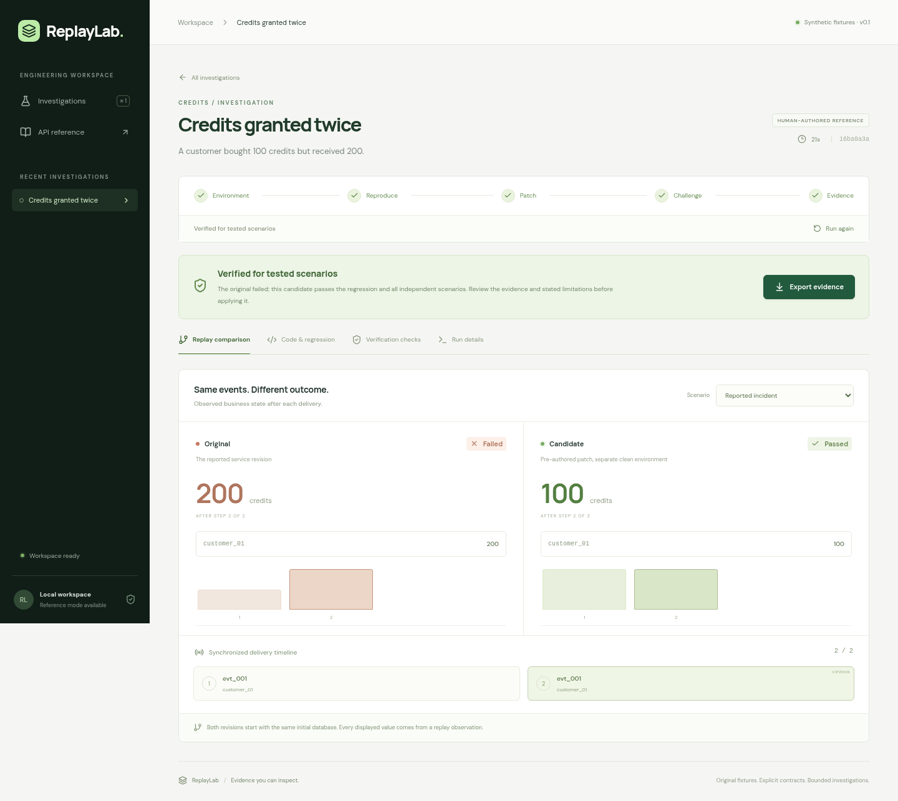

# ReplayLab

[](https://github.com/SlunkySloth/NVIDIA_HACKATHON/actions/workflows/verify.yml)

ReplayLab reproduces synthetic webhook incidents, compares a candidate patch
against independent business checks, and exports replayable evidence. The local
demo includes duplicate credit grants, repeated fulfillment, and stale subscription
updates. Each investigation requires approval of an explicit behavior contract.

Local reference mode runs the actual FastAPI/SQLite fixture and a human-authored
patch. It makes no model calls. The flawed comparison demonstrates why a regression
alone is insufficient: in-memory deduplication passes duplicate delivery but fails
after a process restart.

See [current status](docs/status.md), [verified prerelease](docs/release-verification.md), [architecture](docs/architecture.md),
[supported inputs](docs/supported-inputs.md), [evaluation evidence](docs/evaluation.md),
and [Nebius setup/deployment](docs/nebius-setup.md).



[Watch the narrated local reference walkthrough](https://github.com/SlunkySloth/NVIDIA_HACKATHON/releases/download/v0.1.0-prelive/replaylab-reference-demo.mp4).
It shows actual service execution and a human-authored patch, with zero inference.
Live provider verification and a public hosted application are still pending.

## Run the local demo

Use Linux and Python 3.12 or newer. Run commands from the repository root.

```bash
python3 -m venv .venv
.venv/bin/python -m pip install -r requirements.lock
npm ci --prefix apps/web
npm run build --prefix apps/web
PYTHONPATH=backend .venv/bin/python -m replaylab.cli serve
```

Open http://127.0.0.1:8000. Choose a sample, review its contract, and select
**Run reference investigation**. Inspect the synchronized state timeline, code
diff, regression result, and independent scenario matrix. **Export evidence**
downloads the exact inputs, handlers, tests, observations, and artifact hashes.

The API reference is at http://127.0.0.1:8000/docs. Use a single API worker;
the queue and investigations persist in `.replaylab/`. An interrupted active run
becomes inconclusive after restart and can be retried from a clean state.

For frontend development, keep the API on port 8000 and run
`npm run dev --prefix apps/web`; Vite proxies API requests to it.

## CLI investigations and replay

```bash
PYTHONPATH=backend .venv/bin/python -m replaylab.cli investigate credits
PYTHONPATH=backend .venv/bin/python -m replaylab.cli investigate credits --mode flawed
PYTHONPATH=backend .venv/bin/python -m replaylab.cli investigate --incident evals/holdout/holdout-retry-after-restart.json
PYTHONPATH=backend .venv/bin/python -m replaylab.cli sample subscriptions > /tmp/subscriptions.json
PYTHONPATH=backend .venv/bin/python -m replaylab.cli reproduce /path/to/evidence.zip
```

An investigation prints its evidence path. `reproduce` verifies archive hashes,
supported fixture revisions, contract approval, and the scenario generator, then
reruns both revisions and the regression without generating a new patch. Exit codes
are 0 for verified or not reproduced, 1 for a rejected patch, and 2 for inconclusive
execution or invalid input. Local replay permits only the repository's vetted source.

Import incident JSON through the UI. The schema is published at
`/api/schema/incident`; the `sample` command produces compatible input. Imports
support the three vetted handlers and their published business semantics. They do
not accept executable code or arbitrary repositories.

## Verification

```bash
.venv/bin/pytest -q
.venv/bin/ruff check backend fixtures tests scripts
PYTHONPATH=backend .venv/bin/python -m replaylab.cli evaluate --all-flaws --repeats 2 --output evals/local-baselines.json
npm run build --prefix apps/web
npm run test:e2e --prefix apps/web
```

Tests require localhost sockets and local process execution. Browser tests launch
the built app on port 8765; install Playwright Chromium if needed with
`cd apps/web && npx playwright install chromium`. To use an installed Chrome,
set `REPLAYLAB_BROWSER_PATH` to its executable path.

The baseline evaluation covers 139 scenario/source combinations, each repeated
twice. It measures authored synthetic development cases, including five deliberately
defective patch variants. It does not measure model repair quality or production
reliability. The complete observed results are in `evals/local-baselines.json`.

## Live integration

The live adapter is implemented but has not been verified by local reference tests.
It requires configured NVIDIA model inference and Token Factory Sandbox access,
including a prepared immutable image built from `deploy/sandbox.Dockerfile`.
The [setup guide](docs/nebius-setup.md) explains account access, image preparation,
actual provider preflight, and persistent HTTPS deployment on Nebius Compute.
Server configuration names are listed in `.env.example`; export them into the
server process. The application does not automatically load `.env` files.

Live mode generates a regression and at most two candidate patches, and executes
them remotely. It never executes generated code through the local reference adapter.
The default run timeout is eight minutes. Public demo mode permits unchanged
curated synthetic incidents only.

```bash
PYTHONPATH=backend .venv/bin/python -m replaylab.cli doctor
PYTHONPATH=backend .venv/bin/python -m replaylab.cli prepare-sandbox --output .replaylab/sandbox-image.json
PYTHONPATH=backend .venv/bin/python -m replaylab.cli doctor --live --output .replaylab/live-preflight.json
PYTHONPATH=backend .venv/bin/python -m replaylab.cli evaluate-incidents --split holdout --mode live --max-runs 8 --max-tokens 320000 --output evals/holdout-live.json
```

Preparation and `--live` commands require privately configured access and consume
provider credits. The default `doctor` reports missing configuration names without
echoing keys; it does not call providers. Evaluation retains every planned and
attempted case, including failures and clean controls. See [live evaluation](docs/live-evaluation.md).

To provide read-only evidence for visitors, execute actual investigations and
save explicitly labelled recordings:

```bash
PYTHONPATH=backend .venv/bin/python -m replaylab.cli seed-recordings --fixture all --mode reference --include-flawed
```

Stop the API before standalone investigations or evaluations use its data
directory; they acquire the same exclusive worker lease. For live hosted
recordings, use the temporary container commands in the setup guide while the
API is stopped, then restart it. Reference recordings remain labelled human-authored. Opening a
saved recording makes no inference call. [Demo recording](docs/demo-script.md),
[operations/backups](docs/operations.md), [user testing](docs/user-testing.md), and
[submission draft](docs/submission.md) cover the remaining delivery workflow.

The supported fault model is serial delivery and process restart with persistent
SQLite state. Concurrent workers, external payment or shipment effects, and arbitrary
languages are outside scope. A verified verdict establishes the tested behavior.

`plan.md` is the original proposal; its live deployment and submission items remain
project goals rather than evidence of completed work.

Original application code and synthetic fixtures are released under the
[MIT license](LICENSE). Dependency and model licenses apply separately; this
application license does not relicense third-party code or model weights.
