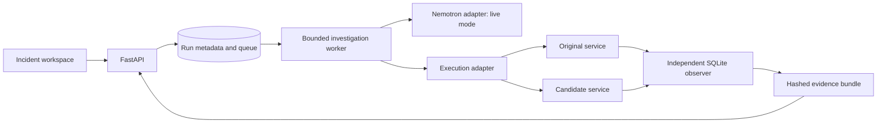

# ReplayLab architecture

The React workspace submits a reviewed incident to a FastAPI control API. SQLite
stores a copy of the input, an idempotent run request, progress events, and the
result. One worker consumes the durable queue. A process-level filesystem lease
prevents two API workers from using the same metadata directory.

An investigation first reproduces a business-state violation. A regression must
fail on an assertion against the original before a patch is considered. Both the
regression and independent scenarios must pass on the candidate. Final scenarios
are withheld from patch feedback. A bounded reducer finds a smaller observed
counterexample; its result is a local minimum under single-step removal, not a
proof of globally minimal failure.

Reference mode permits only vetted fixture revisions and human-authored baselines in
this checkout. Each replay starts a separate FastAPI process with a fresh SQLite
database. Restart steps replace the process while retaining that scenario's
database. The observer reads business state directly from SQLite, independently
of candidate HTTP responses. Resource limits are applied in a separate launcher,
avoiding a subprocess `preexec_fn` inside the worker's background thread.

Live mode uses an OpenAI-compatible inference adapter and the pinned Contree SDK.
The configured immutable image starts a root observer, which executes candidate
code as an unprivileged user. Generated code is never sent to the local adapter.
This path still requires a real provider smoke test; local checks do not establish
remote account access, image compatibility, cancellation, or isolation behavior.

Cancellation freezes the persisted verdict and stops active execution. A server
restart marks previously leased active runs inconclusive instead of resuming from
an uncertain external state. Completed results and queued work remain durable.
SSE progress has persistent event IDs, so the browser can reconnect and inspect
an investigation after a reload. Private artifacts are scoped to the session
cookie. A separate read-only recording API publishes completed unchanged
synthetic sample runs after explicit CLI export; its UI labels their mode and
does not launch new execution or generation.

The application runs from a source checkout or a revision-labelled non-root
container, with one worker and persistent metadata/artifact storage. Nebius
Compute Terraform and HTTPS Compose definitions are prepared. A CLI snapshots
SQLite and evidence into private backups. Actual provider preflight, public
deployment, retention decisions, and judging access remain release gates.
