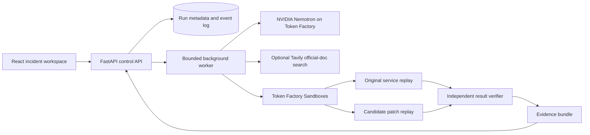

# ReplayLab — implementation and submission plan

Prepared September 29, 2026 for the Nebius x NVIDIA Global AI Hackathon.

Status: researched proposal, not an implemented product. All performance numbers below are targets or illustrative calculations unless explicitly identified as sourced facts. No idea can guarantee a prize; this plan aims to produce strong, reviewable evidence against all four judging criteria.

## 1. What to build

**ReplayLab turns a webhook incident into a reproducible failure, a proposed code fix, and an evidence package showing what the fix actually survived.**

Target user: a backend engineer at a small SaaS company who owns webhook integrations and is investigating incorrect credits, duplicated fulfillment, or stale subscription state.

Primary track: **Coding and Agentic Engineering**. NVIDIA Nemotron reasons about the incident, writes a regression test, and proposes patches. Token Factory Sandboxes execute the application and tests from controlled starting states.

One-sentence pitch:

> ReplayLab reproduces the webhook bug, fixes it, and challenges the fix with the deliveries that could break it again.

The centerpiece is a side-by-side view: the same event sequence against original and patched code, with the business state after every delivery. The user can inspect the smallest observed failing sequence, the diff, the generated regression test, the independently defined checks, and the remaining limitations.

### The signature demo

An original, deliberately buggy sample SaaS sells usage credits. A purchase should grant 100 credits once. The webhook handler grants credits whenever it receives the purchase event.

1. Load a sample incident: “A customer bought 100 credits but received 200.”
2. Show two deliveries of the same event and the resulting balance of 200.
3. Nemotron inspects the handler, event log, and explicit business contract.
4. ReplayLab generates and runs a regression test that fails on the original code.
5. Nemotron proposes a patch in a separate sandbox branch.
6. ReplayLab reruns the incident and challenges the patch with additional deliveries.
7. Show the corrected balance of 100, plus a second legitimate purchase reaching 200.
8. Export the patch, test, replay data, and verification report.

The second legitimate purchase matters: a bad patch that ignores every later event would stop duplicates while breaking the product. The system must detect that.

After the basic example works, use a pre-authored flawed patch as a clearly labeled comparison: it remembers event IDs only in process memory and fails after a restart. Do not pretend this particular mistake was spontaneously generated by the model. If a live generated candidate fails, display its real failure instead.

### Why this problem is credible

Duplicate deliveries and event ordering are real integration concerns. Stripe's official documentation discusses duplicate events and states that event delivery order is not guaranteed. That establishes the problem class; it does not establish demand for this particular product. We will validate demand with engineers. [Stripe webhook documentation](https://docs.stripe.com/webhooks)

Our demo uses original synthetic events and a local credit ledger, with no real charges or customer accounts. It illustrates a webhook reliability problem without requiring access to a production payment system.

## 2. Why choose this project

These comparisons are planning judgments, not estimates of winning probability.

| Candidate | Attractive quality | Main difficulty for this build | Decision |
| --- | --- | --- | --- |
| General personal assistant | Broad usefulness | Hard to demonstrate dependable autonomy and specific differentiation in three minutes | Do not choose without a distinctive workflow and real users |
| Generic repository repair agent | Direct coding-track fit | Existing tools already address issue-to-patch workflows | Narrow to incident replay and behavior verification |
| Robotics or physical simulation | Strong visual appeal | Hardware, simulation fidelity, and integration add schedule risk | Avoid without existing hardware or domain expertise |
| Document/research copilot | Straightforward MVP | Evidence of impact and originality would need a strong specialized dataset | A reasonable alternative, but less directly aligned with sandbox execution |
| ReplayLab | Visible failure-to-fix transformation, executable evidence, natural infrastructure fit | Deterministic replay and trustworthy checks require careful scope | Recommended |

SWE-agent already takes repository issues and attempts fixes. We should not claim that issue-to-patch automation is new. ReplayLab's proposed differentiation is the focused combination of event-sequence reconstruction, business-state comparison, restart/retry challenges, and a portable evidence bundle. This is a product hypothesis, not a claim that no competitor has similar features. [SWE-agent repository](https://github.com/SWE-agent/SWE-agent)

### Strategy against the judging criteria

| Criterion | What we will demonstrate | Evidence to prepare |
| --- | --- | --- |
| Technological implementation | Nemotron writes tests and patches; Nebius runs original and patched application code; verifier checks behavior independently | Runtime trace, sandbox IDs, pinned revisions, red/green tests, reproducible benchmark |
| Design | A complete investigation from incident import to reviewable export | Clear sample entry point, event timeline, diff, recovery states, downloadable output |
| Potential impact | An engineer can obtain a reviewable reproduction and fix for a narrow, recognizable incident class | Observed user sessions, time-to-evidence, interview findings, successful and failed cases |
| Quality of idea | Treat event histories and business outcomes as the unit of investigation | Minimal counterexamples, legitimate-event checks, restart-sensitive failures |

The provided rules give these criteria equal weight and use technological implementation first when breaking ties. Reserve time for product quality and evidence, not only model orchestration.

## 3. Assumptions, time, and scope

Planning assumption: one developer, approximately 100–130 focused hours between September 30 and October 29. Team size, skill level, available credits, and daily availability are unknown. This is a reference schedule, not an assertion about the user's capacity.

Based on the supplied rules, submission closes **October 30, 2026 at 10:00 a.m. Pacific**, which is **10:30 p.m. India Standard Time** that day. Target submission on October 29 to preserve a buffer. Keep judging access operational through **December 15, 2026 at noon Pacific**, equivalent to **December 16 at 1:30 a.m. IST**. Plan infrastructure funding through December 16 IST.

### Must ship

- Python-only webhook services using one supported FastAPI/SQLite adapter.
- Three original fixture services: credit grants, order fulfillment, subscription state.
- A curated public demo that requires no user API keys.
- Incident JSON import with a published schema and a documented local workflow for compatible repositories.
- Real runtime Nemotron calls through Token Factory.
- Actual execution in Token Factory Sandboxes for the coding-track submission.
- A failing reproduction before any patch is labeled verified.
- At most two candidate patch attempts per incident.
- Independent contract checks, plus generated regression tests.
- A before/after event timeline and code diff.
- Exportable evidence with exact inputs, versions, results, and reproduction instructions.
- Honest failure states, bounded spending, and a public repository with a license.

### Add only after the core passes its gates

- Runtime Tavily documentation retrieval with visible citations.
- Snapshot-based comparison of multiple patch branches.
- Deterministic crash/restart cases and sequence minimization beyond duplicates.
- A reviewer-exported pull-request description; actual GitHub PR integration is optional.
- A fourth compatible repository supplied by an external tester with permission.

### Explicitly out of scope

- Automatic production deployment or merging patches.
- General support for arbitrary languages, frameworks, or repositories.
- Live production webhook interception, billing actions, or ingestion of private customer logs in the public demo.
- Claims of exactly-once behavior across external systems.
- Formal verification or proof that a patch is universally safe.
- Kubernetes, custom model training, a vector database, a large agent framework, and multiple cloud deployment targets for the first release.
- Arbitrary concurrent distributed-system replay. Controlled serial delivery and process restarts are the supported fault model.

If only 40–60 hours are available, ship one fixture service, three bug variants, one patch attempt, duplicate/restart checks, and the same polished evidence workflow. Drop Tavily and additional integrations before dropping verification or deployment reliability.

## 4. Verified platform facts and unresolved dependencies

Research was performed on September 29, 2026. Recheck the account console before implementation because documentation does not prove account entitlement or continued model availability.

| Item | Evidence available now | Required implementation check |
| --- | --- | --- |
| Token Factory inference | Official quickstart documents an OpenAI-compatible API at `https://api.tokenfactory.nebius.com/v1/` | Make a real call with an accessible NVIDIA model and record the exact model ID |
| Nemotron 3 Super | Nebius published an availability announcement | Check current catalog, license link, pricing, rate limits, and tool-call behavior in this account |
| Sandboxes | Official docs describe beta execution, checkpoints, branching, and OCI images | Verify access, image import, file retrieval, cancellation, quotas, and isolation controls |
| Sandbox onboarding | ConTree's announcement describes an access application | Apply immediately; do not assume inference access implies sandbox access |
| Structured output and tools | Official documentation exists for both | Test the selected model and endpoint; retain schema validation and bounded repair |
| Tavily | Official SDK exposes domain filtering and search results | Verify credentials and relevance on three domain-specific questions before adding it |

Sources: [Token Factory quickstart](https://docs.tokenfactory.nebius.com/quickstart), [Nemotron Super announcement](https://nebius.com/blog/posts/nemotron3-super-now-available), [Sandbox overview](https://docs.tokenfactory.nebius.com/sandboxes/overview), [Sandbox access announcement](https://contree.dev/blog/contree-joins-token-factory/), [Tool calling](https://docs.tokenfactory.nebius.com/ai-models-inference/function-calling), [Structured output](https://docs.tokenfactory.nebius.com/ai-models-inference/json), [Tavily Python SDK](https://github.com/tavily-ai/tavily-python).

### Access decision by October 2

Preferred path: working Token Factory inference and Sandboxes. Proceed with Coding and Agentic Engineering.

If Sandboxes remain unavailable, continue deterministic replay locally only as development work. Seek organizer clarification about coding-track execution requirements. Do not describe ordinary Docker or another vendor's sandbox as Token Factory Sandboxes.

Fallback product: retain ReplayLab as a webhook incident investigation app, use runtime Nemotron inference through Token Factory, and execute only curated fixtures in an isolated hosted worker. Submit under Best Apps and Agents if the final workflow genuinely matches that track; verify that choice with organizers rather than relying on a cosmetic category change. This fallback loses some sponsor-specific differentiation, but preserves the core product.

No deployment provider, paid resource, or credential has been provisioned by this planning task.

## 5. User experience

### Screen 1: Start an investigation

Show three incident cards in plain language:

- “A customer received credits twice.”
- “An order was fulfilled twice after a retry.”
- “An old event changed the subscription back to an outdated state.”

Each card displays the observed symptom and expected behavior. The primary button is “Investigate sample.” A secondary import flow accepts a compatible incident bundle. Keep the public demo on vetted service revisions; repository onboarding remains a documented local workflow initially.

**Why:** judges need a useful path immediately, without connecting GitHub or supplying sensitive logs.

### Screen 2: Review the behavior contract

Display the input event sequence, initial state, expected outcome, and model-proposed assumptions. The user confirms or edits the intended behavior before the fix is evaluated. Curated samples have pre-authored contracts.

**Why:** logs show what happened, not necessarily what should happen. The model must not silently decide business semantics.

### Screen 3: Investigation workspace

Use three areas:

1. Event timeline: deliveries, retries, restarts, and resulting business state.
2. Investigation progress: preparing environment, reproducing, patching, challenging, exporting.
3. Findings: observed failure, source locations, candidate diff, and test outcomes.

Display elapsed time and completed work. Show model name and execution provider in an expandable run-details panel. Show concise evidence-linked explanations, not raw hidden reasoning or an endless agent transcript.

**Why:** users need to understand progress and inspect evidence without reading orchestration internals.

### Screen 4: Compare and export

Synchronize original and patched timelines. A scenario selector switches between original delivery, duplicate delivery, legitimate second purchase, and restart/retry when supported.

Status vocabulary:

- **Verified for tested scenarios:** original failure reproduced; candidate passes all required checks.
- **Patch rejected:** show the counterexample.
- **Not reproduced:** original behavior did not violate the stated contract.
- **Needs clarification:** intended behavior or initial state is missing.
- **Inconclusive:** infrastructure, timeout, or test collection failure.

The export button downloads a patch and evidence bundle. Do not label the outcome “production safe.”

**Why:** the user should know exactly what evidence supports a review decision and what remains untested.

## 6. Architecture and technology choices



| Component | Proposed choice | Reason |
| --- | --- | --- |
| UI | React, TypeScript, Vite, a small reusable component set | A focused interactive comparison without unnecessary server-rendering complexity |
| API | FastAPI with Pydantic schemas | Same language as replay tooling; explicit validation at boundaries |
| Orchestration | A small Python state machine | Bounded retries and inspectable transitions are more valuable here than framework breadth |
| Model adapter | OpenAI-compatible Python client pointed at Nebius | Matches documented API style; NVIDIA model selected in configuration |
| Execution | Token Factory Sandboxes through an adapter using documented SDK operations | Necessary execution boundary and natural track alignment |
| App metadata | SQLite on a persistent disk, one worker initially | Enough for low-concurrency judging; fewer infrastructure dependencies |
| Artifact storage | Persistent local directory initially; object storage if deployment needs it | Preserve replay bundles independently of sandbox lifetime |
| Fixture services | FastAPI + SQLite, pinned Python dependencies | Easy reproducible initial state, transactions, and process restarts |
| Tests | pytest and deterministic event generators | Concrete behavioral checks with machine-readable outcomes |
| Browser validation | Playwright for the critical investigation flow | Exercises the user-visible product, including disconnect/reconnect |
| Hosting | One small persistent Linux host for UI/API/worker; remote sandbox execution | Straightforward operational model with explicit persistence |

SQLite here is a scoped deployment decision, not a general recommendation for large multi-worker workloads. If moving to ephemeral serverless hosting, add external durable metadata and artifact storage first. Do not assume a serverless process will keep running after an HTTP response.

### Proposed repository layout

```text
NVIDIA/
  plan.md
  README.md
  LICENSE
  .env.example
  apps/web/
  backend/replaylab/
    api/
    orchestration/
    models/
    sandboxes/
    replay/
    verification/
    artifacts/
  fixtures/
    credits/
    fulfillment/
    subscriptions/
  contracts/
  evals/
    development/
    holdout/
    baselines/
    results/
  tests/
  docs/
    architecture.md
    supported-inputs.md
    evaluation.md
    feedback.md
    demo-script.md
    submission.md
  deploy/
```

### API surface to implement

| Endpoint | Purpose |
| --- | --- |
| `GET /api/fixtures` | List supported sample incidents |
| `POST /api/incidents` | Validate and persist an incident bundle |
| `PUT /api/incidents/{id}/contract` | Save the reviewed behavior contract |
| `POST /api/runs` | Start an investigation with an idempotency key |
| `GET /api/runs/{id}` | Return current state and summary |
| `GET /api/runs/{id}/events` | Stream persisted progress via SSE with reconnect support |
| `POST /api/runs/{id}/cancel` | Cancel pending work and active sandbox operations |
| `GET /api/runs/{id}/artifacts` | List and download scoped artifacts |
| `GET /health` | Report application readiness without exposing credentials |

Opaque run IDs are not authorization. Tie private uploads and downloads to a session/owner; expose only synthetic sample reports publicly.

## 7. Core data contracts

Define these before building UI or prompts so all components agree about what a run means.

### IncidentBundle

Required fields:

- `schema_version`, `incident_id`, and human-readable symptom.
- Supported repository/fixture identifier and exact revision.
- Runtime image digest or reproducible build definition.
- Initial database fixture and its hash.
- Ordered deliveries containing event ID, entity ID, event type, payload, recorded arrival time, and explicit sequence index.
- Optional process restart steps between deliveries.
- Behavior contract ID, version, and approval state.
- Fixture provenance and redaction status.

Keep delivery time separate from event occurrence time. Neither is automatically a reliable entity version. Reordering tests must follow the contract's documented semantics.

### BehaviorContract

For the credit example:

- Each unique successful purchase grants its stated credits once.
- Repeating the same event does not grant more credits.
- Two distinct purchases both grant credits, including when they have equal amounts.
- A restart does not erase deduplication state.
- A failed transaction can be retried without losing or doubling the intended update.
- Duplicate delivery produces the documented successful acknowledgement.

Contracts must specify deduplication keys. Event identity and business-operation identity are not always the same; the initial fixture uses event identity, while cross-event semantic duplicates are outside scope unless explicitly modeled.

### ReplayResult

Record sequence, seed, initial-state hash, final-state digest, per-step observed state, process exit status, test collection count, assertion failures, and infrastructure errors separately.

### RunManifest

Record repository revision, image digest, prompt version, exact model IDs, input hashes, contract hash, scenario-generator version, sandbox operation IDs, patch hash, test hashes, timestamps, token usage, and cost estimates with pricing date.

Hashes establish artifact identity; they are not external attestation that execution was trustworthy.

## 8. Step-by-step implementation

### Step 1 — Validate access and problem demand

**When:** September 30–October 1. **Estimate:** 6–8 hours. **Dependency:** none.

Actions:

1. Register/join the event, confirm personal/team eligibility, and apply for builder credits and sandbox access.
2. Run one NVIDIA model request through Token Factory; save a redacted response with the resolved model name and token usage.
3. Run a small Python test in a sandbox; retrieve stdout, exit status, and one artifact.
4. Check cancellation and a second run from a clean starting state.
5. Record account-specific limits and current pricing. Never paste secrets into source files or this document.
6. Interview three backend engineers, if available. Ask about their last duplicate or stale-event incident, what evidence they needed, and how they knew a patch was correct.
7. Ask whether they would try a tool on a sanitized sample; do not claim users or testimonials until they participate.

**Why:** account access and the user's actual debugging workflow are the two largest early uncertainties.

**Done when:** a real model call and sandbox test succeed, or the fallback decision is explicitly recorded; at least one concrete engineering workflow has been discussed. If interviews are unavailable, mark impact as unvalidated and continue with documented problem evidence.

### Step 2 — Build one complete incident fixture

**When:** October 2–3. **Estimate:** 7–9 hours. **Dependency:** input schema agreed.

Actions:

1. Implement the original credit service, initial database, and deterministic event JSON.
2. Deliberately include the duplicate-credit bug in an identified fixture revision.
3. Write the behavior contract manually, including the legitimate second purchase case.
4. Write an independently authored correct implementation to validate the harness. Keep it out of agent inputs and retrieval paths.
5. Produce a reference failing trace and passing trace by running both implementations.
6. Build a pinned runtime image with dependencies preinstalled.

**Why:** a known incident lets us separate model failures from replay-engine failures. The correct reference establishes that the scenario is solvable, but must not leak into generation.

**Done when:** the original produces 200 for a repeated 100-credit event, the reference produces 100, and both accept two distinct purchases as 200 where appropriate.

### Step 3 — Implement deterministic replay before AI

**When:** October 4–6. **Estimate:** 10–12 hours. **Dependency:** Step 2.

Actions:

1. Implement a runner that resets the database and launches the service for each scenario.
2. Deliver events sequentially through the application's HTTP boundary; capture responses and state snapshots through a fixture-specific observer.
3. Supply an explicit clock/random seed where fixture code needs them. Avoid wall-clock sleeps as an ordering mechanism.
4. Add bounded transformations: repeat an event, delay its arrival, reorder permitted deliveries, and restart the process between deliveries.
5. Define a small scenario catalog instead of enumerating all permutations.
6. Implement sequence reduction: remove a delivery, reset state, rerun, and retain the removal only if the same contract violation remains.
7. Preserve causal prerequisites while minimizing; report a locally minimal counterexample, not the globally shortest possible sequence.
8. Add timeout, output-size, and memory limits; distinguish infrastructure failure from application failure.

**Why:** the agent needs trustworthy observations. A replay engine that changes state between runs can make an incorrect patch appear successful.

**Done when:** the same input produces the same business-state result over 10 clean runs, and removing the necessary duplicate causes the reproducer to stop failing.

**Scope note:** application-visible reproducibility is the claim. Full operating-system or distributed-network determinism is not.

### Step 4 — Connect the sandbox execution adapter

**When:** October 6–7. **Estimate:** 6–8 hours. **Dependency:** access verified and local runner works.

Actions:

1. Define our own adapter interface: prepare environment, execute replay, collect artifacts, cancel, and release resources. These are internal methods, not assumed vendor API names.
2. Implement the interface using the current documented Nebius SDK/API.
3. Import the pinned image, inject explicit input files, and execute the same runner used locally.
4. Save a clean baseline checkpoint before any incident has modified the database.
5. Branch original and candidate runs from the clean state. If snapshot semantics are unsuitable, rebuild from the same image and database fixture.
6. Export artifacts to durable storage immediately; don't depend on long-term sandbox retention.
7. Compare local and remote replay results for the same case.

**Why:** sandbox execution is central to both the product's containment boundary and the coding track. Validate it before building a complex agent loop.

**Done when:** original and reference cases produce matching semantic outcomes locally and remotely, and cancellation leaves no uncontrolled work running.

### Step 5 — Add Nemotron diagnosis and regression-test generation

**When:** October 8–10. **Estimate:** 10–12 hours. **Dependency:** Steps 3–4.

Actions:

1. Implement a model adapter with configurable exact model IDs, token limits, request timeout, and usage collection.
2. Provide the incident, reviewed contract, a bounded file map, selected source files, and actual replay evidence.
3. Ask for a structured diagnosis: suspected location, supported explanation, missing information, and proposed test change.
4. Give the model narrow tools: list/read supported files, search source, submit a test file, request replay, and inspect bounded results.
5. Validate every tool argument and reject path traversal, oversized output, or edits outside allowed locations.
6. Run the generated test on the original service and verify it fails because of the stated behavior, not syntax, imports, missing fixtures, or collection failure.
7. Allow one repair of malformed output or a broken test; then stop with a useful result.

**Why:** a patch should follow an observed defect. Generating a plausible test is insufficient unless it actually detects the original behavior.

**Done when:** at least two development incidents produce a meaningful failing regression test from fresh model calls. Save complete run metadata.

### Step 6 — Generate and independently challenge candidate patches

**When:** October 11–14. **Estimate:** 13–16 hours. **Dependency:** Step 5.

Actions:

1. Ask Nemotron for a minimal source patch tied to the contract and observed failure.
2. Apply the patch only to allowed source files in a fresh candidate environment.
3. Reject edits to original tests, external contract checks, dependency locks, fixture observations, and test configuration.
4. Run the generated regression test, existing tests, and deterministic contract scenarios.
5. If a candidate fails, return the smallest relevant counterexample to the model and allow one revised candidate.
6. Evaluate both candidates from identical clean initial state. Never reuse the first candidate's mutated database.
7. Run final evaluation scenarios that were not returned to the patching loop.
8. Produce a verdict from verifier results; the model may explain the verdict but cannot choose it.

**Why:** the same model can make correlated mistakes in a fix and its tests. Independently authored contracts and held-back scenarios reduce that risk.

**Done when:** the good reference is accepted, intentionally bad patches are rejected, and a timeout or zero collected tests can never produce a verified verdict.

Verification boundary: execute black-box contract checks in a separate evaluator process against candidate HTTP behavior and observed state. Generated code must not be able to edit evaluator files or forge a passing JSON report. Do not rely on a read-only directory alone if candidate code shares evaluator process privileges.

### Step 7 — Build the product interface and run lifecycle

**When:** October 15–18. **Estimate:** 12–15 hours. **Dependency:** one end-to-end backend run.

Actions:

1. Build sample selection, contract review, and investigation screens.
2. Add persisted progress events and SSE reconnect from the last event ID.
3. Implement before/after event playback using actual stored replay observations.
4. Show the code diff, test summary, and scenario matrix with keyboard-accessible controls.
5. Support refresh, cancellation, retry from a clean state, and artifact download.
6. Add concise explanations for rejected patches, unsupported input, and provider failure.
7. Keep a saved real run available with a clear “Recorded run” label alongside “Run live.”

**Why:** the design score depends on a coherent product, and a slow or failed model call should still produce a understandable experience.

**Done when:** a new tester can select an incident, understand the failure, review a fix, and download evidence without verbal coaching. Refreshing the page must not lose the run.

### Step 8 — Expand the evaluation set and optional documentation research

**When:** October 19–21. **Estimate:** 10–12 hours. **Dependency:** stable first workflow.

Actions:

1. Add fulfillment and subscription fixtures only within the same supported adapter.
2. Create the development/holdout split described below before adjusting prompts on additional cases.
3. Run the baseline and full system under matched budgets.
4. If the core is stable, add Tavily search restricted to relevant official documentation domains.
5. Use retrieved documentation to explain a protocol assumption, such as duplicate delivery behavior; store URL, query, retrieval time, and a short supporting excerpt.
6. Keep business-contract approval with the user. Documentation cannot decide application-specific credit or fulfillment rules.

**Why:** additional cases demonstrate breadth, while optional runtime research gives Tavily a real role instead of an ornamental API call.

**Done when:** a reproducible results table exists with failures included. Tavily is included only if its output visibly informs the investigation and a real runtime call is recorded.

### Step 9 — Deploy, observe real usage, and improve reliability

**When:** October 22–25. **Estimate:** 10–12 hours. **Dependency:** Step 7 and evaluation harness.

Actions:

1. Deploy the pinned application build behind HTTPS with durable data storage and server-side credentials.
2. Run through installation from a clean checkout using only the README.
3. Invite three testers to try curated incidents; obtain consent before quoting them.
4. Record time to first understandable evidence, confusing screens, and whether they would review the exported patch.
5. Exercise provider timeout, worker restart, failed sandbox preparation, SSE interruption, and cancellation.
6. Add readiness checks, error reporting, artifact backups, and a documented restart procedure.
7. Reserve credits and infrastructure budget through the end of judging.

**Why:** a stable hosted product and genuine observations carry more weight than extra untested features.

**Done when:** ten consecutive sample investigations complete or produce correct recoverable failure states, a clean installation succeeds, and judging access requires neither payment nor the judge's own API key.

### Step 10 — Package and submit the evidence

**When:** October 26–29. **Estimate:** 8–10 hours. **Dependency:** working deployed release.

Actions:

1. Freeze the feature set and tag the release used in the video.
2. Write the README, architecture overview, evaluation report, limitations, and feedback using actual observations.
3. Record a public YouTube demo under three minutes with spoken Nebius/NVIDIA attribution.
4. Publish the source repository with a detectable open source license and all required assets.
5. Test every submission link from a logged-out browser and follow the README from a clean environment.
6. Submit on October 29 and retain a copy of the exact text, URLs, and release identifier.
7. Check the official rules and updates again immediately before submission.

**Why:** the deliverable is the working product plus its judge-facing evidence. Packaging can determine whether technical work is understood at all.

**Done when:** every submission checklist item is satisfied and Devpost confirms submission.

## 9. Runtime agent design

Use logical roles within one bounded orchestrator, not an autonomous swarm. Separate roles mean different inputs and permissions; they do not require separate infrastructure or simultaneous agents.

| Role | Inputs | Allowed output/actions | Cannot do |
| --- | --- | --- | --- |
| Investigator | Incident, contract, relevant code, observations | Diagnosis and regression test | Change the contract or declare success |
| Patch author | Diagnosis, failing test, bounded counterexamples | Source diff within allowed paths | Modify verifier or hidden scenarios |
| Documentation researcher, optional | Sanitized protocol question | Official-source results and citations | Receive private source/logs or execute web instructions |
| Deterministic verifier | Immutable contracts, scenarios, observed candidate behavior | Verdict and evidence | Delegate correctness to model confidence |

Start with one accessible Nemotron model that performs adequately on the development set. Nemotron 3 Super is a candidate, subject to live availability. Add an available Nano variant for routing/summarization only if measured quality and cost justify it. Consider Ultra only after confirming access and demonstrating an improvement on hard cases. Do not invent model identifiers from marketing names.

### State machine

```text
CREATED -> INPUT_VALIDATED -> CONTRACT_READY -> ENVIRONMENT_READY
  -> REPRODUCING -> REPRODUCED -> PATCHING -> VERIFYING -> EXPORTED

Alternate terminal/intermediate states:
  NEEDS_CLARIFICATION, UNSUPPORTED, NOT_REPRODUCED,
  PATCH_REJECTED, INCONCLUSIVE, CANCELLED, FAILED
```

Persist each transition and its input/output hashes. A worker lease prevents duplicate processing. After a crash, resume only when the previous operation can be reconciled; otherwise mark it inconclusive and restart from a clean checkpoint. HTTP retries must not create duplicate model or sandbox work accidentally.

Initial per-run limits: two patch candidates, 12 model calls, two documentation searches, 12 replay scenarios per candidate, 40 reduction attempts, and an eight-minute wall-clock timeout. These are configurable engineering starting points, not promises about provider limits. Reserve output tokens before every call; stop before exceeding the configured run budget.

## 10. Replay correctness and difficult cases

### Scenario families

| Family | Transformation | Expected behavior | Scope |
| --- | --- | --- | --- |
| Exact duplicate | Deliver one event two or three times | One business effect | Core |
| Legitimate repetition | Deliver two distinct purchases with equal amount | Two business effects | Core |
| Interleaved entities | Alternate events for two customers/orders | Correct independent state for both | Core |
| Restart | Process event, restart, redeliver | Deduplication survives restart | Core once persistence runner works |
| Out-of-order | Deliver versioned state updates in a supported permutation | Contract-defined final state | Subscription fixture only |
| Transaction failure | Raise a controlled error between local write stages | Retry yields one complete effect | Stretch with explicit fault hooks |
| True concurrent deliveries | Overlap multiple workers | Requires database concurrency reasoning | Out of MVP scope |
| External provider crash window | Crash between local state and external side effect | Requires protocol/outbox analysis | Out of MVP scope |

Only permute events where the fixture contract defines the desired result. A timestamp comparison alone is not a universal subscription correctness rule. Our subscription fixture should use an explicit entity version, and clearly state that real providers may require fetching authoritative current state.

For controlled transaction failures, use fixed fixture hooks that the patch cannot remove. Distinguish injected exceptions from actual process termination. Do not claim realistic crash durability from an exception-only test.

### Required bad-patch checks

- In-memory deduplication fails restart tests.
- “Ignore every later event” fails legitimate second-purchase tests.
- Deduplication by amount fails equal-value distinct purchases.
- Deduplication shared across customers fails interleaved-entity tests.
- Changing the test instead of the service is rejected by patch policy.
- Returning success without updating state fails observed-state checks.
- A process exiting before tests run is not treated as success.

A passing suite establishes evidence within its fault model. Unsupported concurrency and external side effects remain explicit limitations in every exported report.

## 11. Evaluation plan

### Dataset

Target 12 original small incidents across the three fixture services: six development and six held-out incidents. Include duplicate processing, overly broad deduplication, stale state, and retry-after-restart variants. Add two clean/no-defect controls separately to test whether the agent invents unnecessary fixes.

Split by implementation/bug variant, not merely by different customer IDs or random seeds. Freeze holdout inputs and check hashes before final evaluation. Publish the full dataset at submission for reproducibility, while keeping holdout cases and reference patches unavailable to the agent's tool paths during runs.

This small synthetic benchmark cannot establish performance on general production repositories. Label it accurately. One external compatible example is useful evidence if time and permission allow, but it does not turn the benchmark into a representative industry study.

### Baselines and ablations

1. **One-shot baseline:** same Nemotron model, code, incident, contract, and final evaluation; one patch attempt with no replay feedback.
2. **Matched-budget baseline:** same model and maximum calls/tokens, ordinary test feedback, without the event-transformation search and minimization.
3. **ReplayLab:** full supported replay and independent verification workflow.

Use identical held-out evaluation for all methods. Report actual spend and latency, not just allowed budgets. If time is tight, preserve the one-shot comparison and clearly explain its unequal interaction budget; do not attribute every improvement solely to replay.

### Metrics and definitions

| Metric | Definition |
| --- | --- |
| Reproduction rate | Defective incidents where the original violates the correct contract during replay / attempted defective incidents |
| Verified fix rate | Defective incidents with a candidate passing original, regression, and held-out checks / attempted defective incidents |
| False verification rate | Candidates labeled verified by development checks but rejected by final independent checks / candidates labeled verified; report numerator and denominator |
| Clean-case false repair rate | No-defect controls unnecessarily changed / no-defect controls |
| Counterexample quality | Original sequence length versus locally minimized failing sequence length |
| Time to evidence | Submission to first real reproduced contract failure |
| End-to-end time | Submission to terminal result, including failed runs |
| Cost per verified fix | Total evaluation spend, including failures / verified fixes |
| UI task completion | Testers reaching a correct interpretation and export without coaching / testers |

Run each final held-out incident three times if affordable. Report per-case results and aggregate counts; do not treat repeated runs of one case as independent product users. Distinguish variation in model generation from deterministic replay results. Never silently discard failures or choose only the best run.

### Engineering gates, not claimed results

- Deterministic replay yields the same business-state output across 10 repeats per flagship scenario.
- All deliberately bad patches above are rejected.
- At least 4 of 6 held-out defective cases are repaired within the chosen budget as an initial release target.
- Zero known false verifications on the final small suite; report the sample size and limitations.
- Median flagship time to reproduced evidence below 45 seconds with a prepared image.
- Median flagship full investigation below 120 seconds; hard timeout at eight minutes.
- At least 2 of 3 testers complete the primary workflow without coaching.

If model repair misses the gate, reduce the supported incident class and improve context/tool feedback. Do not tune on holdout cases and continue calling them held-out. Record new development cases and create fresh final evaluation cases when necessary.

## 12. Data handling, containment, and execution boundaries

These controls are required by this product's execution model, not decorative enterprise features.

- Keep API keys in server-side environment/secrets configuration; exclude them from sandbox inputs and artifacts.
- Limit public hosted execution to vetted fixture revisions. Arbitrary user repositories can contain malicious installation hooks and need a separately designed ingestion path.
- Run generated source only inside the sandbox boundary, never in the API process.
- Treat repository files, logs, and retrieved documentation as untrusted content. They cannot change tool permissions, patch policy, or spending limits.
- Validate archives before extraction: reject absolute paths, traversal, symlinks escaping the workspace, and decompression bombs.
- Preinstall dependencies from pinned, reviewed lockfiles. Reject agent-proposed package installation for the MVP.
- Verify whether network egress can be restricted. If unavailable, keep sandboxes free of credentials and private data; do not advertise network isolation or support sensitive uploads.
- Separate evaluator privileges/processes from candidate code. Observe real API/database state rather than accepting candidate-written pass/fail files.
- Redact obvious credentials, email addresses, and sensitive headers before model calls. The public demo uses synthetic data because automatic redaction is imperfect.
- Enforce per-session access to artifacts, path containment, retention, and deletion for private local/hosted workflows.
- Export concise model explanations and tool observations, not hidden chain-of-thought.
- Terminate operations on cancellation and expiry, and cap disk/output consumption.

Be precise about privacy: source and sanitized incident data are sent to the configured Nebius inference service. Do not claim everything remains on-device or promise retention properties that have not been configured and verified.

## 13. Cost and judging availability

No verified price quote or existing credit balance is assumed. Set a budget after Step 1 using current account pricing.

For each run:

```text
inference_cost = sum((input_tokens / 1,000,000) * input_rate
                   + (output_tokens / 1,000,000) * output_rate)
total_run_cost = inference_cost + sandbox_cost + search_cost + storage_cost
```

Follow provider billing semantics for cached or reasoning tokens and avoid double counting. Save the pricing date and mark estimates as estimates until reconciled with billing.

For an illustrative 100-run evaluation, 30,000 input and 8,000 output tokens per run would mean 3 million input and 0.8 million output tokens total. Multiply by measured model rates; this is arithmetic for planning, not a prediction of actual usage.

Suggested allocation of the eventual budget: 35% development, 25% evaluation, 30% judging/hosting reserve, 10% contingency. Adjust only after real usage measurements.

Controls:

- Default one active expensive run per session and a small worker queue.
- Cap tokens, patch attempts, replay cases, operation duration, and search requests.
- Display estimated spend internally and reconcile periodically.
- Cache images and dependencies; do not substitute cached model answers for live generation without disclosure.
- Preserve recorded runs for inspection, but keep a functioning live path available to judges.
- Maintain a funded judge access path and follow the rules' free/unrestricted testing requirement. Public anti-abuse controls must not impose a paywall, BYO-key requirement, or arbitrary evaluation quota on judges.
- Alert before reserves run low. A budget stop should show an honest unavailable status; it does not satisfy the working-demo requirement by itself.

## 14. Calendar and checkpoints

| Dates | Deliverable | Decision at checkpoint |
| --- | --- | --- |
| Sep 30–Oct 1 | Real model/sandbox smoke test, interviews started | Confirm access or start fallback |
| Oct 2–3 | First buggy service, contract, reference solution | Is the observed failure unambiguous? |
| Oct 4–7 | Local/remote replay and evidence capture | Does clean replay reproduce reliably? |
| Oct 8–10 | Model diagnosis and failing regression test | Can the model use the tools correctly? |
| Oct 11–14 | Patch loop and independent rejection checks | Can we reject superficially plausible bad fixes? |
| Oct 15–18 | Complete incident UI and export | Can a new user understand the result? |
| Oct 19–21 | Additional fixtures, baseline, optional Tavily | Do measured results support the pitch? |
| Oct 22–25 | Hosted beta, user sessions, resilience | Can judges use it reliably? |
| Oct 26–28 | Feature freeze, video, README, feedback | Does every claim have evidence? |
| Oct 29 | Submission and logged-out access audit | Confirm successful submission |
| Oct 30 | Buffer for submission problems | No speculative feature additions |
| Oct 31–Dec 16 IST | Maintain judging access | Preserve release and uptime; follow submission modification rules |

Critical path: access → deterministic original failure → real model-generated test → candidate execution → independent checks → usable hosted workflow → submission assets.

First features to cut if late: GitHub integration, optional search, model routing, extra fixtures, additional patch branches. Protect the flagship workflow, test integrity, export, deployment, and video.

## 15. Risks and concrete responses

| Risk | Early signal | Response |
| --- | --- | --- |
| Sandbox access delay | Smoke test unavailable by Oct 2 | Seek organizer clarification and activate the documented fallback |
| Model struggles to patch | Repeated syntax errors or no meaningful fix on first two cases | Narrow file context and tools; one model; smaller supported fixture class |
| AI can game its tests | Patch touches tests or only generated test passes | Enforce patch paths and independent black-box contract checks |
| Incorrect business assumptions | Different engineers expect different outcomes | Require an explicit reviewed contract; return needs-clarification |
| Replay flakes | Same original input changes outcome | Remove timing dependencies and limit fault model before adding AI |
| Strong demo but no breadth | Only one known case ever succeeds | Add separately implemented holdout variants and publish failures |
| Weak differentiation | Reviewers see only another coding chatbot | Lead with event replay, state comparison, and rejected false fixes |
| Scope expands | Requests for arbitrary repos or distributed tracing | Keep adapter contract and defer unsupported stacks |
| Provider latency/cost | Flagship takes many minutes or burns reserve | Prepare images, shorten context, reduce branches; retain honest progress |
| Misleading live demonstration | UI animates a stored result without disclosure | Separate live and recorded modes visibly |
| Credit expiry before judging | Grants end near submission | Verify expiry in Step 1 and reserve another funded path |
| Synthetic benchmark overclaim | Pitch implies broad production performance | Label fixtures synthetic and report narrow support explicitly |

## 16. Demo video plan — target 2 minutes 45 seconds

| Time | Visual | Spoken point |
| --- | --- | --- |
| 0:00–0:15 | Credit balance 200; one 100-credit purchase, two deliveries | Explain the user and concrete incident |
| 0:15–0:35 | Load incident and review expected behavior | Show what information ReplayLab needs |
| 0:35–0:55 | Actual failing replay and regression test | Show that the original defect was reproduced |
| 0:55–1:20 | Generated patch and synchronized before/after state | Explain the fix and the observed effect |
| 1:20–1:45 | Restart/legitimate-event checks; rejected flawed candidate if available | Show why a superficial fix is insufficient |
| 1:45–2:05 | Export bundle and repeat one replay | Demonstrate reviewability and reproducibility |
| 2:05–2:25 | Run details and simple architecture | State NVIDIA model name, Token Factory inference, and actual Sandbox execution aloud |
| 2:25–2:45 | Measured evaluation table and user observation | Describe supported scope, actual result, and next use case |

Record working software. If editing out waiting time, label the time jump and preserve actual elapsed runtime in the UI. A prerecorded successful run can support the video, but it must be genuine and the hosted demo must remain usable. Use no invented speedup, adoption, savings, or success-rate claims.

Prefer original screen recordings and narration; avoid third-party music or branding assets without permission. Avoid spending the first minute on slides or generic explanations of AI.

## 17. Evidence package and README

Each completed run should export:

```text
run-manifest.json
incident.redacted.json
contract.json
candidate.patch
generated_regression_test.py
scenarios.json
original-results.json
candidate-results.json
verification-summary.md
replay-instructions.md
```

Replay instructions must identify the required image/build, input hashes, and exact command. Reproducing the recorded patch outcome should not require generating the patch again. A separate live command should rerun the agent and may produce a different patch.

README content, in order:

1. The concrete problem and one screenshot/GIF of the result.
2. Demo URL, public video, and supported scope.
3. Exact NVIDIA model and Nebius services used at runtime.
4. Local installation and environment variables with no secrets.
5. One command to replay a bundled incident without inference credentials.
6. Separate instructions for a live Nebius-powered investigation and required access.
7. Architecture and execution/data boundaries.
8. Benchmark command, results, and limitations.
9. Licensing, fixture provenance, and third-party notices.
10. Troubleshooting, judging instructions, and feedback link/file.

Use MIT for original application code if suitable for the contributors. Preserve dependency notices and NVIDIA model license references separately; the application license does not relicense model weights or third-party content.

## 18. Required tool feedback

Maintain `docs/feedback.md` from the first real call. Record observations as they occur rather than reconstructing them at submission.

For each meaningful item record: tool/model/version, date, task, expected behavior, actual behavior, redacted reproduction, frequency, impact, workaround, and proposed improvement.

Useful topics if actually encountered: time to first successful sandbox run, access errors, artifact retrieval ergonomics, cancellation behavior, model tool-call validity, structured-output errors, rate-limit clarity, and cost visibility. Include positive results with evidence as well as problems. Do not manufacture complaints or praise.

The organizers explicitly ask for specific tool feedback and clear spoken sponsor/model attribution in the video. [Organizer submission guidance](https://nebiusglobalaihackathon.devpost.com/updates/46205-how-to-build-a-winning-project)

## 19. Submission checklist

Based primarily on the complete rules supplied in this conversation; recheck the [official rules](https://nebiusglobalaihackathon.devpost.com/rules) before submitting.

- [ ] Confirm eligibility and register; appoint a representative if entering as a team.
- [ ] Select one track matching actual final functionality.
- [ ] Make a real runtime Token Factory inference call or run on qualifying Nebius compute.
- [ ] Use at least one NVIDIA open source model as a functional part of the solution.
- [ ] For the chosen coding-track plan, actually write/run/test code in Token Factory Sandboxes.
- [ ] Provide a working demo URL with free judging access through the judging period.
- [ ] Provide login/testing instructions if the judging path is private.
- [ ] Publish all necessary source, assets, setup instructions, and an open source license.
- [ ] Verify that the repository host detects and displays the license.
- [ ] Provide an English project description explaining what, why, and how.
- [ ] Publish a public YouTube demo shorter than three minutes with required spoken attribution.
- [ ] Highlight NVIDIA/Nebius integration in README, description, and Built With fields.
- [ ] Submit specific feedback on services and models actually used.
- [ ] Explain significant in-period changes if any part of the project predates August 26, 2026.
- [ ] Confirm rights to source, fixtures, assets, and any third-party integrations.
- [ ] If seeking Best Use of Tavily, demonstrate a functional runtime Tavily API call.
- [ ] Claim city eligibility only if the entrant actually attended an eligible event.
- [ ] Audit source/history/artifacts for secrets before publication.
- [ ] Check all links while logged out and preserve a tagged, reproducible release.
- [ ] Submit by the October 29 internal deadline and verify the platform confirmation.

The supplied prize rules limit a project to one Overall OR one Track award, plus one Bonus award. Do not spend build time assuming multiple bonuses can be stacked.

## 20. Definition of a competitive finished submission

ReplayLab is ready when a judge can open the demo, understand a concrete webhook incident, watch a real Nemotron-generated test and patch execute on Nebius, inspect why the patch passed or failed independent checks, and download enough evidence to reproduce the result.

The most persuasive claim is narrow and measurable: “On these published incident cases, this system produced these verified outcomes within this measured time and cost.” A polished workflow plus honest evidence is the intended competitive advantage.

Immediate next action: complete Step 1 and make the October 2 access decision before committing the month to sandbox-dependent features.
